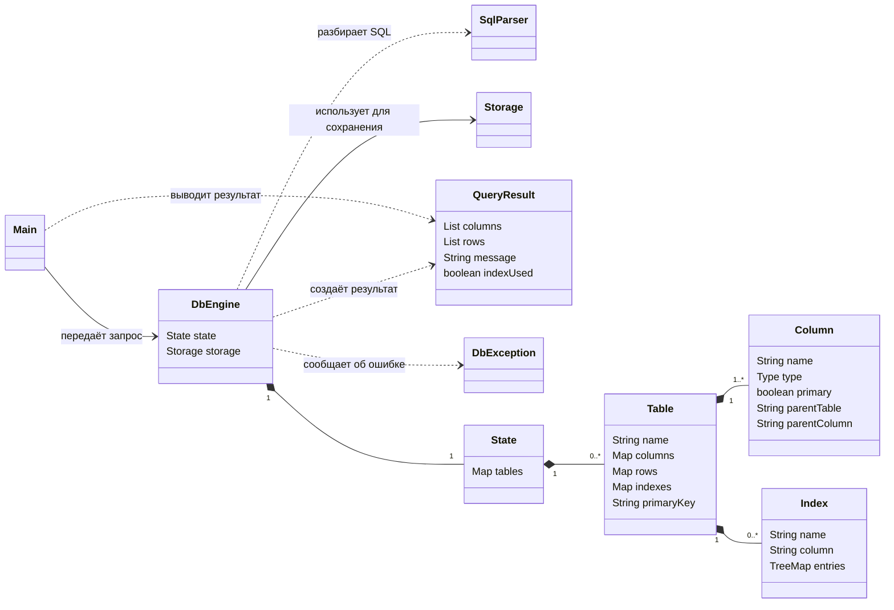
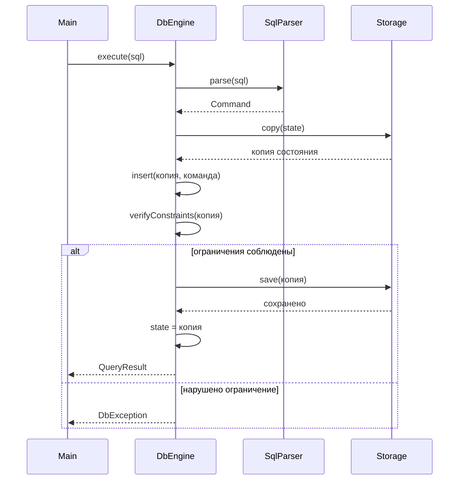

# Лабораторная работа №2. Упрощённая СУБД на Java

## 1 Цель работы

Реализовать небольшую систему управления базами данных, которая хранит несколько связанных таблиц, принимает SQL-подобные запросы и сохраняет данные между запусками. Для хранения использована стандартная сериализация Java. Интерфейс — консольный.

## 2 Предметная область и структура базы

Я выбрала аэропорт. В базе три таблицы: `airlines` (авиакомпании), `flights` (рейсы) и `tickets` (билеты). Одна авиакомпания может выполнять несколько рейсов, а на один рейс может быть продано несколько билетов. Обе связи имеют вид «один ко многим».

```text
airlines (1) ────── (N) flights (1) ────── (N) tickets
    id PK              airline_id FK           flight_id FK
```

**Таблица `airlines`**

| Поле | Тип | Назначение |
|---|---|---|
| `id` | INT | Первичный ключ |
| `name` | STRING | Название авиакомпании |
| `country` | STRING | Страна |

**Таблица `flights`**

| Поле | Тип | Назначение |
|---|---|---|
| `id` | INT | Первичный ключ |
| `code` | STRING | Номер рейса |
| `departure` | DATE | Дата вылета |
| `price` | DOUBLE | Цена билета |
| `active` | BOOLEAN | Активность рейса |
| `airline_id` | INT | Внешний ключ на `airlines.id` |
| `departure_city` | STRING | Город вылета |
| `arrival_city` | STRING | Город прилёта |
| `departure_time` | STRING | Время вылета в формате `ЧЧ:ММ` |

**Таблица `tickets`**

| Поле | Тип | Назначение |
|---|---|---|
| `id` | INT | Первичный ключ |
| `flight_id` | INT | Внешний ключ на `flights.id` |
| `passenger` | STRING | Имя пассажира |
| `checked_in` | BOOLEAN | Прошёл ли регистрацию |
| `baggage_kg` | DOUBLE | Вес багажа |

Используются все пять типов из задания: целый, вещественный, строковый, дата и логический.

Первичный ключ не может быть `NULL` и не допускает повторов. Для внешнего ключа проверяется наличие соответствующей записи в родительской таблице. Внешние ключи могут быть `NULL`, если значение пока не указано. Нельзя удалить авиакомпанию, на которую ссылаются рейсы, или рейс, на который ссылаются билеты. Также нельзя изменить первичный ключ такой родительской записи, пока есть ссылки на неё. Остальные поля изменять можно: например, название авиакомпании.

## 3 Архитектура системы

### 3.1 Основные классы

| Файл | Назначение |
|---|---|
| `Main.java` | Принимает команды из консоли и выводит результаты таблицей |
| `SqlParser.java` | Разбивает запрос на токены и преобразует его в команду |
| `DbEngine.java` | Выполняет запросы, хранит таблицы в памяти, проверяет ключи и индексы |
| `Storage.java` | Сохраняет и загружает состояние базы через сериализацию |
| `QueryResult.java` | Передаёт результат выполнения запроса в `Main` |
| `DbException.java` | Описывает ошибки запросов и ограничений базы |
| `Benchmark.java` | Измеряет время поиска с индексом и без индекса |

### 3.2. Диаграмма классов

Диаграмма показывает основные классы программы и связи между ними. `Main` принимает SQL-запросы, `SqlParser` разбирает их, `DbEngine` выполняет команды и проверяет ограничения, а `Storage` отвечает за сохранение данных. Результат выполнения передаётся через `QueryResult`, ошибки — через `DbException`. Состояние базы (`State`) состоит из таблиц (`Table`), у каждой из которых есть столбцы (`Column`) и могут быть дополнительные индексы (`Index`).



Числа у связей показывают кратность: одно состояние базы содержит любое количество таблиц (`0..*`), у таблицы есть минимум один столбец (`1..*`), а дополнительных индексов может не быть (`0..*`). Пустые секции у некоторых классов — особенность отображения Mermaid: они не означают, что в исходном коде есть дополнительные поля или методы.

### 3.3. Диаграмма последовательности

Диаграмма показывает порядок выполнения команды `INSERT`. `Main` передаёт запрос в `DbEngine`, который обращается к `SqlParser` для разбора SQL. После этого движок создаёт копию базы, добавляет в неё запись и проверяет ограничения. Если проверка пройдена, новая версия сохраняется на диск и становится текущей. При ошибке исходное состояние не меняется.



Для команды `SELECT` копирование и сохранение не нужны: движок находит записи в текущем состоянии базы и возвращает их для вывода в консоль.

### 3.4 Хранение данных и индексы

Строки таблицы находятся в `LinkedHashMap`, где ключ — значение первичного ключа, а значение — сама строка. Это позволяет в среднем находить запись по первичному ключу за `O(1)`.

Дополнительные индексы реализованы через `TreeMap`: каждому значению индексируемого столбца соответствует набор первичных ключей `LinkedHashSet`. Индекс помогает искать как конкретное значение, так и диапазон значений. Он используется для `SELECT`, а после изменения строк пересобирается.

Все таблицы, их схемы, строки и индексы сохраняются сериализацией в `data/database.bin`. При записи нового состояния используется временный файл `data/database.tmp`, а предыдущее состояние может сохраняться в `data/database.bak`. Если основной файл не читается, программа пробует загрузить резервную копию. При таком восстановлении последняя операция может быть потеряна.

При изменениях база сначала копируется в памяти. Новое состояние сохраняется и становится текущим только после проверки ограничений. Это защищает от частичного выполнения некорректной команды. СУБД рассчитана на один работающий процесс.

### 3.5 Сложность операций

Здесь `n` — число строк таблицы, `m` — число различных значений в индексе, `k` — число найденных строк.

| Операция | Поиск или обработка в памяти |
|---|---|
| `SELECT` по первичному ключу с `=` | В среднем `O(1)` |
| `SELECT` без подходящего индекса | `O(n)` |
| `SELECT` с вторичным индексом | `O(log m + k)` для равенства; при диапазоне дополнительно просматриваются подходящие значения индекса |
| `CREATE INDEX` | `O(n log m)` |
| `UPDATE`, `DELETE` | Просмотр строк `O(n)` и пересоздание индексов |

При изменении данных дополнительно копируется и сохраняется состояние базы целиком. Поэтому даже добавление одной строки не является операцией `O(1)` с учётом дисковой записи. Индекс ускоряет чтение, но занимает память и добавляет работу при изменениях.

## 4. Результаты тестирования производительности

Для сравнения скорости поиска с индексом и без него использовался `Benchmark.java`. В ходе эксперимента создавалось 10 000 записей о рейсах, из которых 100 соответствовали условию поиска по полю `code`.

Было проведено пять серий измерений по 300 запросов `SELECT` в каждой. Сначала поиск выполнялся без индекса, затем с индексом на основе `TreeMap`. Для сравнения использовалась медиана средних времён выполнения запросов.

**Результаты измерений в IntelliJ IDEA (Java 26.0.2.1):**

| Серия | Без индекса, мс | С индексом, мс |
|---|---:|---:|
| 1 | 0,230 | 0,015 |
| 2 | 0,180 | 0,013 |
| 3 | 0,173 | 0,009 |
| 4 | 0,160 | 0,009 |
| 5 | 0,160 | 0,010 |
| **Медиана** | **0,173** | **0,010** |

**Отношение медиан — 17,67.**

По результатам эксперимента использование индекса позволило значительно сократить время поиска записей. Без индекса программа последовательно проверяет строки таблицы, а при наличии индекса использует `TreeMap` для поиска подходящих значений.

Измерялось только выполнение `SELECT` в оперативной памяти, без вывода результатов в консоль и сохранения данных на диск.

## 5 Инструкция пользователя

### 5.1 Запуск

**В IntelliJ IDEA:** открыть папку проекта `laba2_airport`, выбрать установленный JDK, открыть `src/Main.java` и запустить метод `main` зелёным треугольником. В окне Run появится приглашение `sql>`. SQL-команды вводятся туда и заканчиваются точкой с запятой `;`. Если команда записана на нескольких строках, ввод продолжается до `;`.

**Через Windows PowerShell** из корня проекта:

```powershell
New-Item -ItemType Directory -Force out | Out-Null
javac -encoding UTF-8 -d out (Get-ChildItem .\src\*.java).FullName
java -cp out Main
```

При первом запуске создаются пустые таблицы `airlines`, `flights` и `tickets`. После закрытия программы данные остаются в папке `data`. Команда `HELP` выводит подсказку, `EXIT` завершает работу. Для обновления предыдущей версии с двумя таблицами программа добавляет недостающие поля и таблицу, не удаляя старые строки; перед обновлением стоит сохранить копию папки `data`.

### 5.2 Поддерживаемые команды

| Команда | Что делает |
|---|---|
| `CREATE TABLE`, `DROP TABLE` | Создание и удаление таблиц |
| `INSERT INTO` | Добавление одной или нескольких строк |
| `SELECT` | Вывод всех или выбранных столбцов |
| `UPDATE ... WHERE` | Изменение записей по условию |
| `DELETE ... WHERE` | Удаление записей по условию |
| `CREATE INDEX`, `DROP INDEX` | Создание и удаление индекса |
| `SHOW TABLES` | Просмотр списка таблиц |

В `WHERE` поддерживается одно условие с `=`, `!=`, `<>`, `<`, `<=`, `>`, `>=`, `IS NULL` или `IS NOT NULL`. Объединение условий через `AND` и `OR` и запросы `JOIN` не реализованы. Для `UPDATE` и `DELETE` условие можно опустить — тогда операция затронет все строки таблицы.

### 5.3 Пример работы с тремя связанными таблицами

Команды ниже выполняются по очереди на пустой базе. Если записи с указанными `id` уже есть, для повторной проверки нужно использовать другие идентификаторы.

**1. Посмотреть исходные таблицы:**

```sql
SHOW TABLES;
```

**2. Добавить авиакомпанию:**

```sql
INSERT INTO airlines (id, name, country)
VALUES (11, 'Aeroflot', 'Russia');
```

**3. Добавить её рейс (ссылка `airline_id = 11`):**

```sql
INSERT INTO flights (id, code, departure, price, active, airline_id, departure_city, arrival_city, departure_time)
VALUES (1001, 'SU100', '2026-11-15', 15000.0, TRUE, 11, 'Moscow', 'Kazan', '09:30');
```

**4. Добавить билет на этот рейс (ссылка `flight_id = 1001`):**

```sql
INSERT INTO tickets (id, flight_id, passenger, checked_in, baggage_kg)
VALUES (2001, 1001, 'Anna', FALSE, 12.5);
```

**5. Проверить данные во всех трёх таблицах:**

```sql
SELECT * FROM airlines WHERE id = 11;
SELECT * FROM flights WHERE airline_id = 11;
SELECT * FROM tickets WHERE flight_id = 1001;
```

**6. Изменить данные и создать индекс:**

```sql
UPDATE airlines SET name = 'Aeroflot Russian Airlines' WHERE id = 11;
UPDATE flights SET departure_time = '10:45' WHERE id = 1001;
CREATE INDEX idx_flights_price ON flights (price);
SELECT id, code, price FROM flights WHERE price >= 10000;
```

Название авиакомпании можно менять, даже если на неё ссылаются рейсы. Но изменить её `id` или удалить её до удаления зависимых рейсов нельзя. Для рейса с существующим билетом действует то же правило.

**7. Проверить сохранение:** ввести `EXIT`, снова запустить `Main.java` и выполнить:

```sql
SELECT * FROM flights WHERE id = 1001;
```

Добавленный рейс должен остаться в базе.

**8. Если нужно удалить эти примеры, сначала удаляются зависимые записи:**

```sql
DELETE FROM tickets WHERE id = 2001;
DELETE FROM flights WHERE id = 1001;
DELETE FROM airlines WHERE id = 11;
DROP INDEX idx_flights_price;
```

**9. Для проверки создания произвольной таблицы можно отдельно выполнить:**

```sql
CREATE TABLE terminals (id INT PRIMARY KEY, name STRING);
INSERT INTO terminals VALUES (1, 'Terminal A');
SELECT * FROM terminals;
DROP TABLE terminals;
```

## 6 Выводы

В работе я реализовала консольную СУБД для аэропорта с тремя связанными таблицами. Программа обрабатывает основные SQL-подобные команды, проверяет первичные и внешние ключи, не допускает некорректное время вылета и сохраняет данные между запусками. Создание и удаление таблиц и индексов также доступно через консоль.

Сравнение показало, что индекс `TreeMap` заметно ускоряет поиск по неключевому полю: в моём измерении — примерно в 17,67 раз. При этом выбранный способ хранения имеет ограничение: после каждого изменения сериализуется всё состояние базы, поэтому для больших объёмов данных запись будет дорогой. Для учебной СУБД мне было важнее реализовать понятную работу с таблицами, связями и запросами.

## 7 Список использованных источников

1. Материалы лекций 1–8 по Java, предоставленные на курсе.
2. Oracle. Java Platform, Standard Edition 8 — API Specification: java.util.LinkedHashMap, java.util.TreeMap, java.util.LinkedHashSet, java.io.ObjectInputStream, java.io.ObjectOutputStream, java.nio.file.Files.
3. Материалы курса Управление данными — для построения диаграмм классов и последовательности.